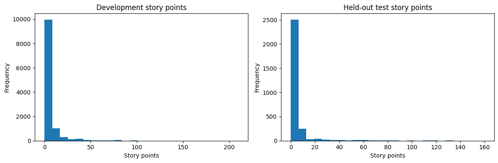
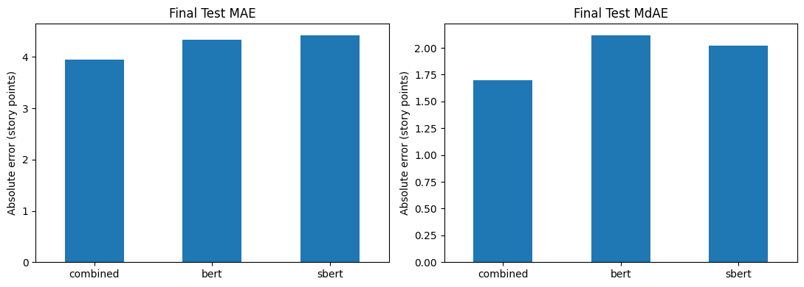

# Combined BERT and SBERT Embeddings for Temporal Story-Point Estimation

**Natural Language Processing Project — Problem Statement 10**   
**GitHub repository:** https://github.com/mhdh9632/tawos-bert-sbert-story-point-estimation  
**Executed Colab:** <https://colab.research.google.com/drive/1IITpLs0qPoyH-MEnmVGMHTFEbK4Cu0yx?usp=sharing>  
**Date:** 11 November 2026

## Abstract

This project investigates whether combining contextual word-level information from BERT with sentence-level semantic information from SBERT improves software story-point estimation for later issues within the same project. Issues from the TAWOS V1.1 dataset were filtered to retain usable text, creation dates, and story-point labels while excluding issues whose text or estimate changed after estimation. Lsstcorp Data Management (`DM`) was selected because it contained the largest eligible sample: 14,782 issues. The oldest 11,825 issues formed the development data, while the newest 2,957 issues were held out for final testing. Five expanding-window validation folds preserved chronological order. Frozen `bert-base-uncased` and `all-MiniLM-L6-v2` encoders produced 768- and 384-dimensional vectors; fusion concatenated them into 1,152 dimensions. The combined model achieved final-test MAE 3.9416 and MdAE 1.6988, outperforming both BERT-only and SBERT-only models. The result supports representation fusion for this target project, although validation MdAE was mixed and the single-project, single-seed design limits generalisation.

## 1. Introduction

Agile software teams use story points to express the relative effort or complexity of implementing an issue. Estimation is difficult because it depends on technical details, project vocabulary, and historical practice. NLP models can learn relationships between issue descriptions and previously assigned story points, allowing effort estimates to be suggested for new issues.

Problem Statement 10 asks whether combined word and sentence embeddings are effective for predicting story points of later issues within the same project. The phrase “later issues” makes temporal evaluation essential: the model must be trained on the past and evaluated on the future. Random splitting would allow later project language and practices to influence training and would not simulate deployment.

The research question is:

> Does concatenating BERT-derived contextual text representations and SBERT sentence embeddings reduce MAE and MdAE when predicting story points for later issues in the same project?

## 2. Dataset

### 2.1 TAWOS

TAWOS V1.1 is a relational dataset of 458,232 issues from 39 open-source projects hosted across 12 public Jira repositories. Its central `Issue` table contains issue text, timestamps, story points, project identity, workflow data, and derived attributes. This study used only fields available for the defined prediction task:

- `Issue_Key` for traceability;
- `Title` and `Description_Text` as model input;
- `Creation_Date` for temporal ordering;
- `Story_Point` as the regression target;
- `Project_ID` to enforce the within-project setting;
- the three changed-after-estimation flags for leakage filtering.

Post-outcome fields—including resolution, resolution date, time spent, total effort, comments, and later workflow state—were not used as predictors.

### 2.2 Eligibility filtering

An issue was retained only if it had usable title or description text, a valid creation timestamp, a finite non-negative story-point label, a recognised project, and no indication that its title, description, or story point changed after estimation. The title and cleaned description were joined with a `[SEP]` marker.

The SQL dump was approximately 4.31 GB and contained very long `INSERT` statements. A memory-bounded parser streamed only the required `Project` and `Issue` columns. The compact extracted table and subsequent artifacts were cached in Google Drive.

### 2.3 Selected project

The notebook profiled all eligible projects and selected the project with the largest valid labelled sample. Lsstcorp Data Management (`DM`) contained 14,782 eligible issues dated from 4 March 2014 to 22 October 2020. Its median story point was 2.0 and mean was 5.9843, indicating a right-skewed distribution with some high-valued issues.



## 3. Experimental Methodology

### 3.1 Temporal holdout

Issues were sorted by creation time, with issue ID used for stable ordering. The newest 20% was reserved before model selection:

| Partition | Issues | Date range |
|---|---:|---|
| Development | 11,825 | 2014-03-04 14:51:50 to 2019-11-07 22:44:03 |
| Final test | 2,957 | 2019-11-07 22:50:12 to 2020-10-22 14:51:07 |

Equal timestamps were kept on the same side of a boundary. The final test set was not used for early stopping, epoch selection, scaling, or any other model-selection decision.

### 3.2 Five-fold temporal validation

Five expanding-window validation runs were constructed within the development portion. Training always began with the oldest data and expanded over time; each validation interval occurred strictly after the corresponding training interval.

| Fold | Training issues | Validation issues | Training end | Validation period |
|---:|---:|---:|---|---|
| 1 | 1,952 | 1,955 | 2016-02-03 12:03 | 2016-02-03 to 2016-11-30 |
| 2 | 3,907 | 1,962 | 2016-11-30 11:36 | 2016-11-30 to 2017-09-28 |
| 3 | 5,869 | 1,993 | 2017-09-28 13:26 | 2017-09-28 to 2018-08-06 |
| 4 | 7,862 | 1,994 | 2018-08-06 13:33 | 2018-08-06 to 2019-04-08 |
| 5 | 9,856 | 1,969 | 2019-04-08 12:41 | 2019-04-08 to 2019-11-07 |

### 3.3 Text representations

Three representations were compared using identical issue partitions:

1. **BERT-only:** `bert-base-uncased` produced contextual token representations. Attention-mask-aware mean pooling produced one 768-dimensional vector per issue.
2. **SBERT-only:** `sentence-transformers/all-MiniLM-L6-v2` produced one 384-dimensional semantic vector per issue.
3. **Combined:** the BERT and SBERT vectors were concatenated, producing a 1,152-dimensional representation.

The encoders were frozen. This made the experiment computationally practical, allowed embeddings to be cached, and ensured that representation comparisons used exactly the same encoder outputs.

### 3.4 Prediction model

Each representation used the same three-layer dense regression head:

```text
Input → Linear(256) → ReLU → Dropout(0.20)
      → Linear(64)  → ReLU → Dropout(0.10)
      → Linear(1)   → Predicted story point
```

Features and targets were standardised using statistics computed only from each training portion. Training used AdamW, Smooth L1 loss, learning rate 0.001, weight decay 0.0001, batch size 64, a maximum of 50 epochs, early-stopping patience 7, and random seed 42. Negative outputs were clipped to zero before evaluation. The median best epoch across five validation runs determined the final training duration for each representation.

### 3.5 Evaluation metrics

Mean Absolute Error (MAE) is the average absolute distance between true and predicted story points. Median Absolute Error (MdAE) is the median distance and is more robust to unusually large errors. Lower values are better for both metrics. MAE describes average prediction error, whereas MdAE better represents a typical issue in this right-skewed dataset.

## 4. Results

### 4.1 Five-fold validation

| Representation | MAE mean | MAE SD | MdAE mean | MdAE SD |
|---|---:|---:|---:|---:|
| BERT | 4.5545 | 0.2809 | 2.0266 | 0.0825 |
| SBERT | 4.5884 | 0.3763 | **2.0242** | 0.2154 |
| Combined BERT + SBERT | **4.5239** | 0.2999 | 2.0961 | 0.1090 |

The combined representation achieved the lowest mean validation MAE, although the difference was small: 0.0306 compared with BERT and 0.0645 compared with SBERT. SBERT achieved the lowest mean validation MdAE. Therefore, fusion did not uniformly dominate both baselines during development validation.

### 4.2 Final held-out test

| Representation | MAE | MdAE | Selected epochs | Dimensions |
|---|---:|---:|---:|---:|
| BERT | 4.3400 | 2.1191 | 3 | 768 |
| SBERT | 4.4238 | 2.0220 | 1 | 384 |
| **Combined BERT + SBERT** | **3.9416** | **1.6988** | 3 | 1,152 |



The combined model achieved the lowest final-test error on both metrics. Relative to BERT-only, fusion reduced MAE by 0.3984 story points (9.18%) and MdAE by 0.4203 (19.83%). Relative to SBERT-only, fusion reduced MAE by 0.4822 (10.90%) and MdAE by 0.3232 (15.98%).

## 5. Discussion

The final result suggests that BERT and SBERT contribute complementary information. BERT’s contextual representation captures token-level technical language, while SBERT emphasises the overall meaning of an issue. Concatenation gives the regression model access to both views and produced a meaningful reduction in error on later unseen issues.

The validation evidence is more nuanced. Combined embeddings achieved the lowest average validation MAE but not the lowest average MdAE. Moreover, all models generally improved in MAE in the later folds. This may reflect increasing training-set size, changes in the project’s issue distribution, or both. The strong final combined result should therefore be interpreted as evidence for this temporal holdout rather than proof that fusion will always outperform individual representations.

Final combined MAE was 3.9416 while MdAE was 1.6988. The larger MAE indicates that a subset of issues produced large errors, consistent with the project’s right-skewed story-point distribution.

## 6. Threats to Validity and Limitations

### Internal validity

- Only one random seed was evaluated, so training variance was not quantified.
- Early stopping selected epoch counts, but a broader hyperparameter search was not performed.
- Although all representations used identical partitions and heads, their input dimensions differed.

### Construct validity

- Story points are team-specific relative estimates, not universal measurements of effort.
- The latest stored text was used only when change flags indicated no later edit; flag accuracy depends on the source dataset.
- Text was truncated to 256 tokens, so long descriptions could lose information.

### External validity

- Results are for the `DM` project and may not transfer to other repositories or teams.
- Encoders were frozen rather than fine-tuned on software-engineering text.
- Historical open-source Jira issues may not represent private industrial projects.

### Conclusion validity

- No repeated-seed confidence interval or statistical significance test was performed.
- Temporal change may affect the held-out interval; one interval cannot characterise every future period.

## 7. Reproducibility

The clean and executed notebooks, fold-level CSV, validation summary, final metrics, plots, split metadata, and JSON configuration are included in the repository. The source SQL dump and generated embedding/model caches are excluded because of their size. Reproduction requires placing `TAWOS.sql` in `MyDrive/TAWOS_NLP/data/raw/`, opening the notebook in a GPU-enabled Colab runtime, and running all cells in order. The detailed demonstration procedure is provided in `DEMO.md`.

## 8. Conclusion

This study implemented a temporally valid within-project story-point estimation experiment using BERT, SBERT, and fused representations. On 2,957 later `DM` issues, combined embeddings achieved MAE 3.9416 and MdAE 1.6988, outperforming both individual representations. The finding supports complementary contextual and sentence-level features for this project. Future work should repeat the experiment across projects and random seeds, investigate software-domain encoders, tune fusion architectures, and test whether the gains remain statistically reliable.

## References

1. Tawosi, V., Al-Subaihin, A., Moussa, R., and Sarro, F. “A Versatile Dataset of Agile Open Source Software Projects.” *Proceedings of MSR 2022*, pp. 707–711. <https://doi.org/10.1145/3524842.3528029>.
2. Devlin, J., Chang, M.-W., Lee, K., and Toutanova, K. “BERT: Pre-training of Deep Bidirectional Transformers for Language Understanding.” *NAACL-HLT 2019*, pp. 4171–4186.
3. Reimers, N. and Gurevych, I. “Sentence-BERT: Sentence Embeddings using Siamese BERT-Networks.” *EMNLP-IJCNLP 2019*, pp. 3982–3992.
4. TAWOS V1.1 dataset. <https://doi.org/10.5522/04/21308124>.

## Appendix A: Fold-level metrics

| Representation | Fold | MAE | MdAE | Best epoch |
|---|---:|---:|---:|---:|
| BERT | 1 | 4.6205 | 1.9664 | 3 |
| BERT | 2 | 4.7768 | 1.9281 | 4 |
| BERT | 3 | 4.7716 | 2.0285 | 3 |
| BERT | 4 | 4.5105 | 2.0769 | 3 |
| BERT | 5 | 4.0931 | 2.1333 | 8 |
| SBERT | 1 | 4.8302 | 2.3262 | 1 |
| SBERT | 2 | 4.8212 | 1.7208 | 1 |
| SBERT | 3 | 4.8659 | 2.0100 | 4 |
| SBERT | 4 | 4.4291 | 1.9999 | 1 |
| SBERT | 5 | 3.9957 | 2.0642 | 6 |
| Combined | 1 | 4.7524 | 2.0580 | 3 |
| Combined | 2 | 4.7501 | 2.0236 | 4 |
| Combined | 3 | 4.6822 | 2.1779 | 4 |
| Combined | 4 | 4.3648 | 1.9808 | 1 |
| Combined | 5 | 4.0699 | 2.2403 | 2 |

